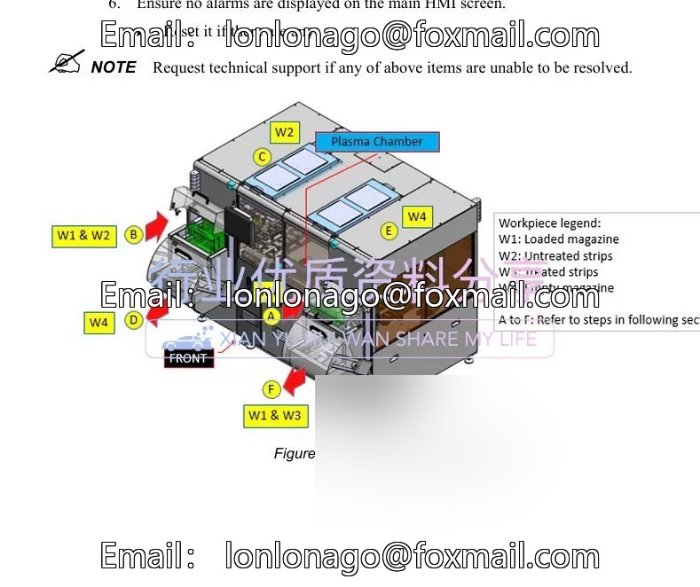
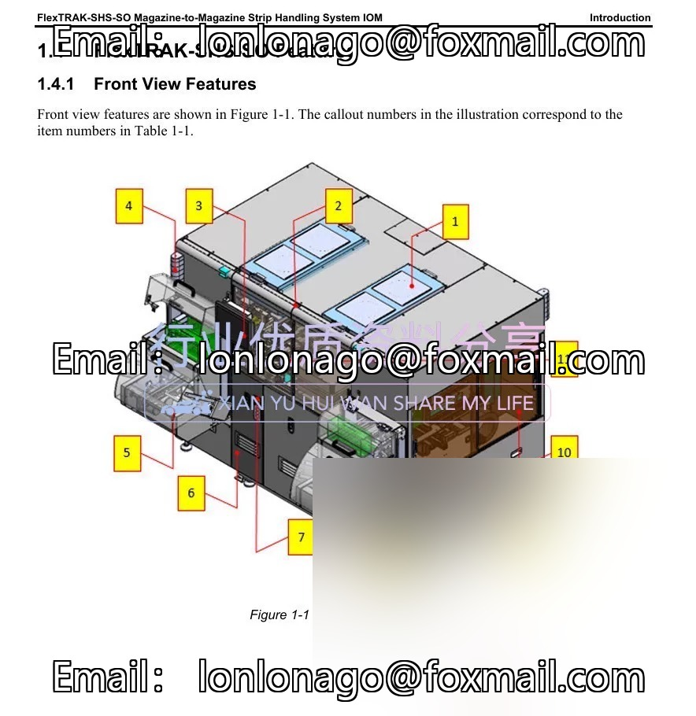
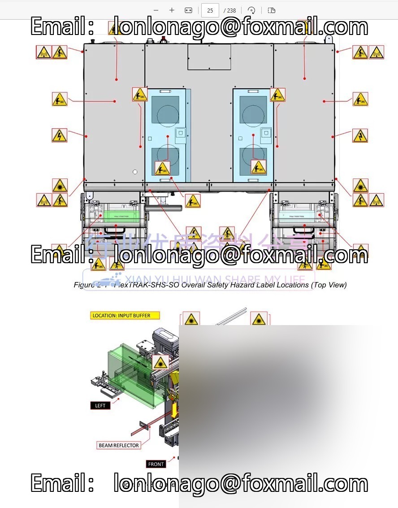
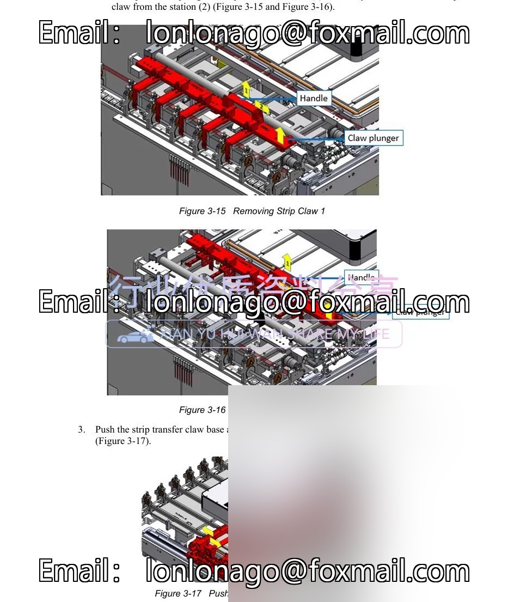
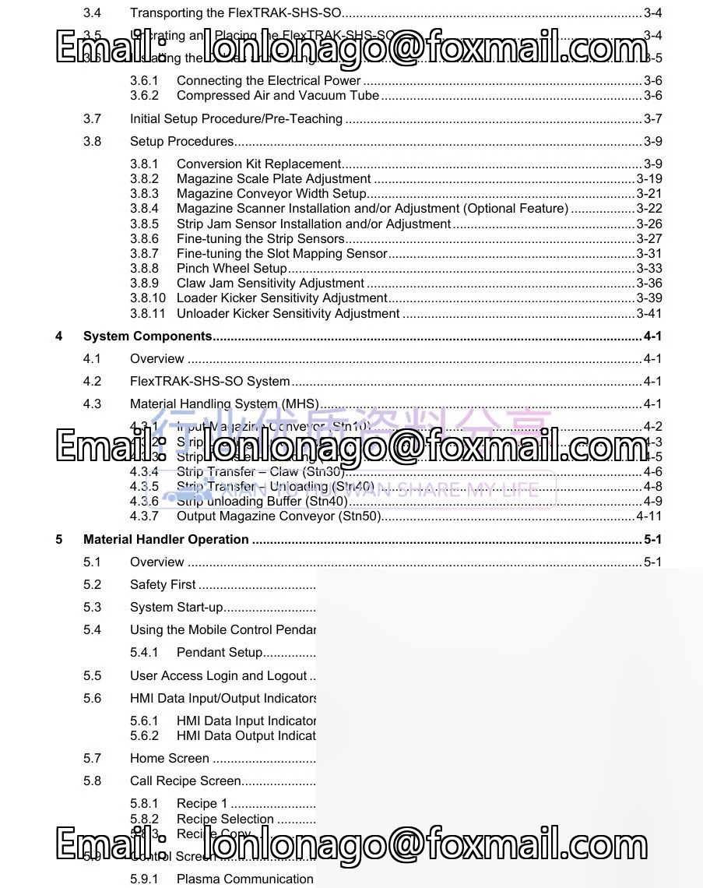

# Semiconductor substrate chip plasma segregation equipment; the equipment PDF document includes detailed structure

## Body

Semiconductor substrate chip plasma sorting equipment  Equipment PDF documents include detailed structural breakdown diagrams and functional descriptions  Images are all high-definition color, which is extremely valuable for those conducting R&D!

Upload directly to for electronic original files! The following image contains a screenshot of the file portion. Please confirm before placing an order! Because electronic file materials are copyable. So after purchase, no return is allowed! Thank you for understanding!

For personal learning and reference use only.

The device PDF includes detailed structural decomposition figures and functional descriptions, presented as high-definition color images, along with direct electronic files for research and reference.

<!-- AI_ENRICHED -->

## Images

## Payment

Here is a pay link on Stripe ( https://buy.stripe.com/3cs8yP7sY87d0vu9AB ). Please contact me lonlonago@foxmail.com after funding $89, and I will send you a complete data files , thank you!

